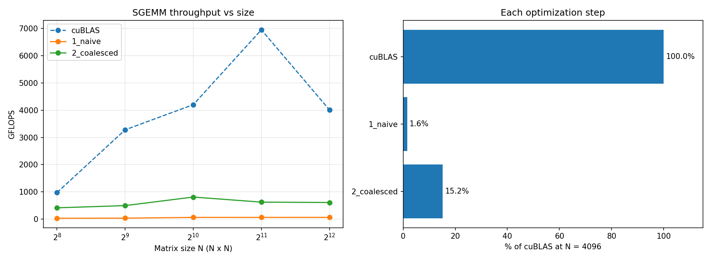

# Optimizing SGEMM in CUDA: 62 → 4,200 GFLOPS on a Tesla T4

Hand-written FP32 matrix-multiply kernels on an NVIDIA Tesla T4 (Turing, sm_75), each step fixing one
bottleneck, benchmarked against cuBLAS with a correctness check on every kernel and size.



## Results

| Kernel | GFLOPS (N=2048) | % cuBLAS | GFLOPS (N=4096) | % cuBLAS | Bottleneck it fixed |
|---|---:|---:|---:|---:|---|
| 1. Naive | 61.8 | 0.9% | 61.6 | 1.4% | — (baseline) |
| 2. Coalesced | 655.3 | 9.1% | 621.1 | 13.9% | Uncoalesced global memory access |
| 3. Shared-memory tiling | 942.3 | 13.1% | 935.0 | 20.9% | Redundant global memory loads |
| 4. 2D register blocking | 4,175.5 | 57.9% | 3,651.5 | 81.8% | Low arithmetic intensity (shared-memory bound) |
| 5. Vectorized (float4) | **4,203.9** | **58.3%** | **3,880.3** | **86.9%** | Number of load/store instructions |
| cuBLAS | 7,215.6 | 100% | 4,463.8 | 100% | — |

**Overall: 68× faster than naive at N = 2048.**

I use **N = 2048 as the headline number**: at N = 4096 cuBLAS throughput dropped from 7,216 to
4,464 GFLOPS, most likely because the T4 (a 70 W card) lowers its clock under sustained load. That
makes the 4096 "% of cuBLAS" figures look better than they really are (see *Observations*).

## What changed at each step

<!-- DRAFT: rewrite each section in your own words before publishing. -->

### 1 → 2: Memory coalescing (10.6×)
In the naive kernel, `threadIdx.x` indexes the row, so the 32 threads of a warp touch 32 different
rows and their addresses are N floats apart. Each warp's access to A and C becomes many separate
memory transactions. Swapping the mapping so `threadIdx.x` indexes the column makes a warp read 32
consecutive floats of B (one 128-byte transaction) and broadcast a single element of A. The math is
identical; only two lines changed.

### 2 → 3: Shared-memory tiling (1.4×)
Each element of A and B is needed by N different outputs, and in kernel 2 each output's thread loads
it separately from global memory. Kernel 3 loads 32×32 tiles into shared memory once per block and
reuses them, cutting global loads per output from 2N to 2N/32. Two `__syncthreads()` are needed: one
so no thread reads a tile before it's fully loaded, one so no thread overwrites it while others still
read it.

The gain is smaller than the 32× reduction suggests because the T4's L1 cache was already catching
much of kernel 2's reuse. After this step the kernel is limited by shared-memory bandwidth: every
multiply-add still needs two shared-memory reads.

### 3 → 4: 2D register blocking (4.4×)
Each thread now computes an 8×8 block of outputs held in registers. Per step it reads 8 values of A
and 8 of B from shared memory and does an 8×8 outer product: 64 multiply-adds per 16 loads, versus
1 per 2 in kernel 3, an 8× better ratio. This was the biggest single improvement. The cost is ~64
accumulator registers per thread, which limits occupancy.

### 4 → 5: Vectorized loads (+0.7% at 2048, +15% at 1024)
Global loads, shared-memory reads and the final stores use `float4` (16 bytes per instruction). The
A tile is stored transposed in shared memory so its reads can be vectorized too. The transposed store
introduces a 2-way bank conflict, but it happens once per 8 k-steps, so its cost is small. The gain
is modest because after kernel 4 the kernel is mostly compute-bound, not instruction-bound.

## Observations

- **Small matrices underuse the GPU.** At N = 256, kernels 4 and 5 are *slower* than kernel 3. With
  128×128 tiles, N = 256 gives only 4 thread blocks, while the T4 has 40 SMs, so 36 SMs sit idle.
  Kernel 3's 32×32 tiles give 64 blocks. Large tiles only pay off once there's enough work to fill
  the GPU.
- **Thermal/power throttling at N = 4096.** All kernels and cuBLAS lost throughput from 2048 to 4096,
  cuBLAS the most (7,216 → 4,464 GFLOPS). Longer runs at full load reduce the T4's clock speed.

## Remaining gap to cuBLAS (~42% at N = 2048)

<!-- DRAFT: verify and expand in your own words. -->
cuBLAS uses techniques these kernels don't:
- **Double buffering:** loading the next tile while computing the current one, hiding memory latency.
- **Warp-level tiling:** organizing work per warp to improve register reuse and reduce shared-memory
  bank conflicts.
- **Per-GPU tuning:** tile sizes and launch configurations chosen for each architecture and matrix size.

## Build and run
```
nvcc -O3 -arch=native -o sgemm sgemm.cu -lcublas
./sgemm          # all kernels
./sgemm 3        # one kernel
python plot.py   # results.png
```

## Method
- GPU: NVIDIA Tesla T4 (Google Colab), CUDA 12
- Square row-major FP32 matrices, values uniform in [-1, 1]
- Correctness: max relative error vs cuBLAS < 1e-3, checked for every kernel and size
- Timing: CUDA events, 1 warm-up + 10 timed runs (3 for N = 4096)
- GFLOPS = 2N³ / time

## References
- Simon Boehm, *How to Optimize a CUDA Matmul Kernel for cuBLAS-like Performance*
